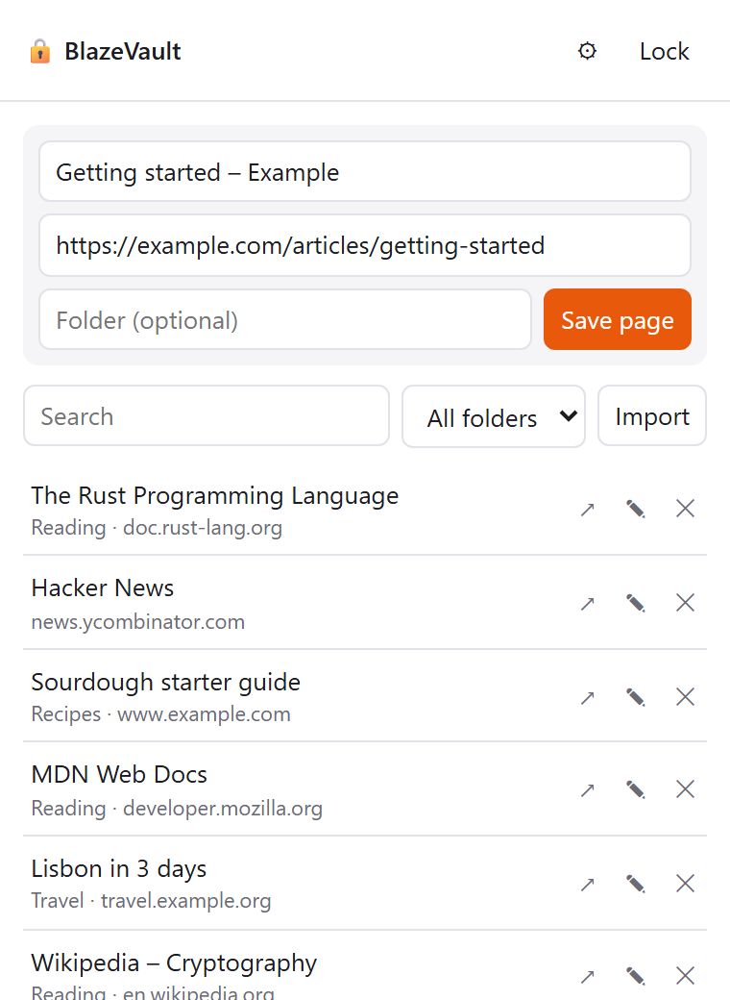
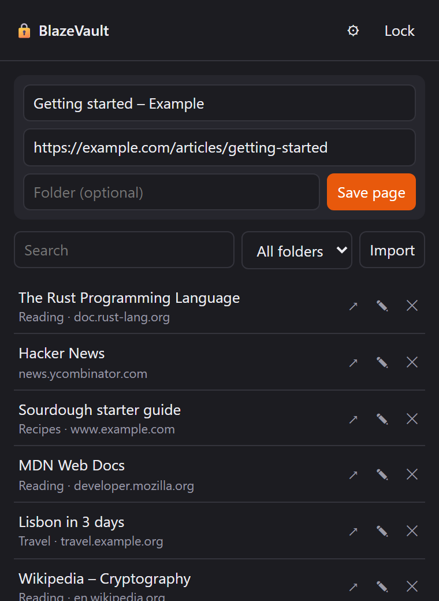
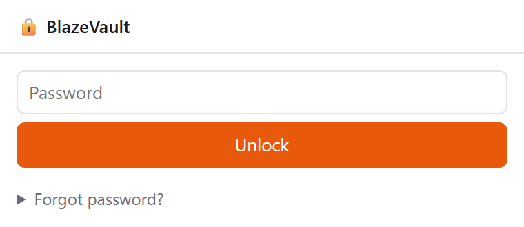
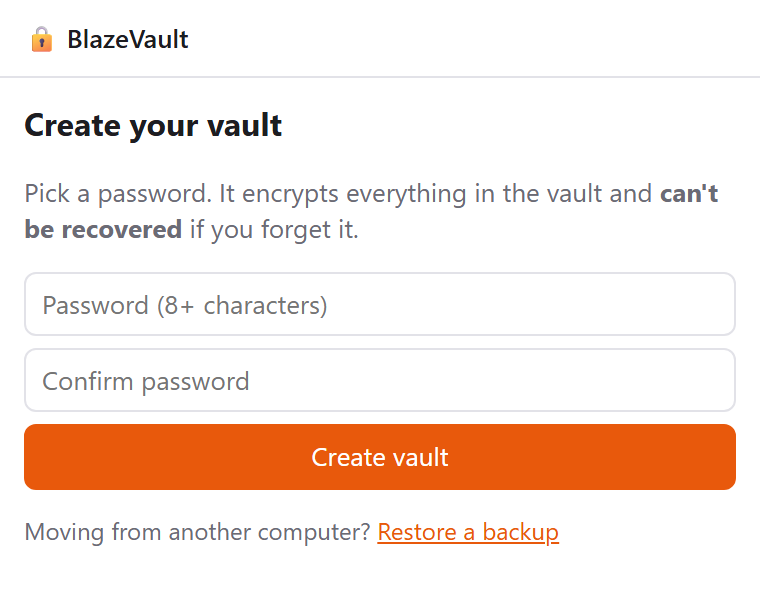
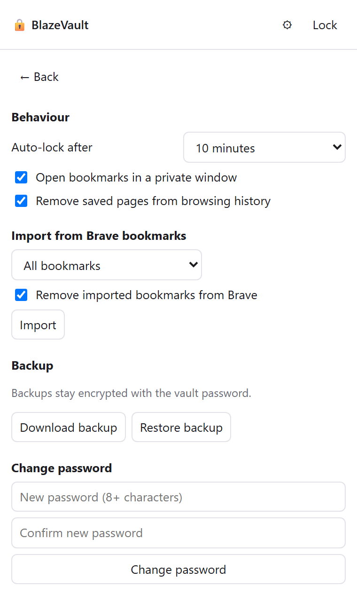

# BlazeVault

A Brave/Chrome extension that keeps private bookmarks behind a password. The bookmarks are
stored encrypted inside the extension instead of in Brave's normal bookmarks, so they don't
appear in the bookmark bar, the bookmark manager, or address-bar suggestions.

  
  

  
  
  

Screenshots use made-up sample bookmarks.

## Install

1. Download this repo (**Code → Download ZIP** and extract it, or `git clone`).
2. Open `brave://extensions` and turn on **Developer mode** (top right).
3. Click **Load unpacked** and select the `BlazeVault` folder.
4. On the BlazeVault card, click **Details** and turn on **Allow in Private**. This lets it open
   bookmarks in private windows.
5. Pin it to the toolbar using the puzzle-piece icon.

After editing the code, click the reload ↻ icon on the BlazeVault card.

## Use

- **First run:** create a password. It can't be recovered, so keep a backup (see below).
- **Save the current page:** open the popup, adjust the title or folder, and click **Save page**.
- **Save from a right-click:** use **Save page/link to BlazeVault**. If the vault is locked, the
  page is held in memory (the toolbar badge shows how many) and added on the next unlock.
- **Open:** click a bookmark. It opens in a private window by default. ↗/🕶 opens it the other way.
- **Import existing bookmarks:** click **Import** next to the search box (or Settings → *Import from
  Brave bookmarks*). Pick **All bookmarks** or a single folder. It can also delete the imported
  bookmarks from Brave afterwards. Folder names are kept.
- **Auto-lock:** after 1–60 minutes without using the vault (default 10), and always when Brave closes.

## Security

- The password is stretched with PBKDF2-SHA256 (600,000 iterations), and the data is encrypted
  with AES-256-GCM. Only ciphertext is written to disk.
- While unlocked, the key is held in `chrome.storage.session`. That storage lives only in memory
  and is wiped when Brave closes.
- **Not protected:** someone who can use your computer can remove the extension, which deletes
  the vault but doesn't reveal it. The Settings page (auto-lock time, private window option) is
  stored unencrypted.
- **History:** pages you save or import are removed from history by default. Anything opened
  outside a private window adds history entries again.
- **Brave Sync:** the vault doesn't sync between computers. If Brave Sync is on, deleting a
  folder during import also deletes it on your other synced devices.

## Backup

Settings → **Download backup** saves the encrypted vault as a `.json` file. It can only be opened
with the vault password. **Restore backup** replaces the vault on this computer. Changing your
password doesn't update old backups, so download a new one afterwards.

## Files

| File | Purpose |
| --- | --- |
| `manifest.json` | Extension manifest (MV3) |
| `vault.js` | Encryption, storage, session/auto-lock |
| `background.js` | Right-click menu, auto-lock alarm |
| `popup.html` / `popup.css` / `popup.js` | Popup UI (also opened as a tab for restoring backups) |
| `screenshots/` | README images |
